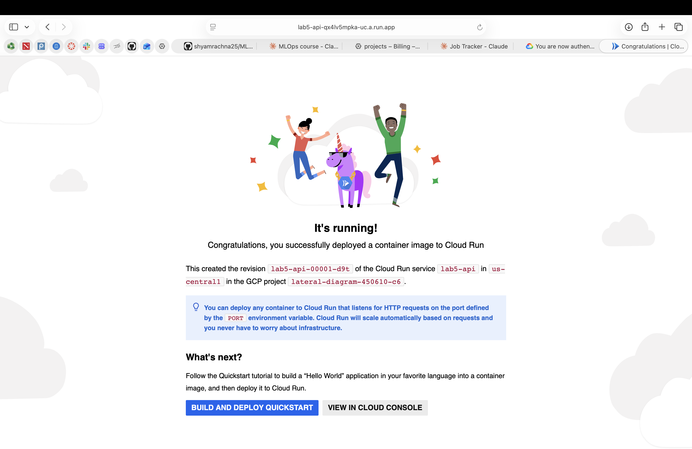

# MLOps Lab 5: Terraform, Meridian-Shaped GCP Infrastructure with an Environment Gate

**Course:** DADS 7305, MLOps, Northeastern University

**Original lab:** [`raminmohammadi/MLOps/Labs/Terraform_Labs/GCP/Lab1_Beginner`](https://github.com/raminmohammadi/MLOps/tree/main/Labs/Terraform_Labs/GCP/Lab1_Beginner)

## Overview

The original lab provisions a single generic VM and a single GCS bucket,
a minimal "does Terraform talk to GCP" smoke test. This submission
replaces that generic demo with infrastructure shaped after **this
course's own final project (Meridian)**, whose architecture docs specify
exactly this stack: Cloud Run Jobs (pipeline), Cloud Run (API), Cloud SQL
(database), GCS (snapshots), and Cloud Scheduler (the daily trigger).

## What's different from the original lab

### 1. A real bug fix: the hardcoded bucket name

The original lab hardcodes:

```hcl
name = "terraform-lab-bucket-unique-12345"
```

GCS bucket names must be **globally unique across all of GCP**, not just
within your project. This name is almost certainly already taken by
someone else who ran this exact lab, meaning `terraform apply` would
fail for most people who try it as written. Fixed by generating a random
suffix (`random_id.bucket_suffix`) and using it in the bucket name.

### 2. Core modification: an environment gate on Cloud SQL

The Cloud SQL instance, Meridian's "only always-on piece" and
therefore its main source of ongoing cost, is gated behind an
`environment` variable:

```hcl
resource "google_sql_database_instance" "db" {
  count = var.environment == "production" ? 1 : 0
  ...
}
```

With `environment = "dev"` (the default), Terraform plans to create
**zero** SQL instances; you can stand up and tear down the rest of the
stack (Cloud Run service, Cloud Run Job, Scheduler, GCS bucket) freely,
with no always-on cost. With `environment = "production"`, the instance,
a database, a user, and a randomly-generated password are all created
for real.

This is the same "gate" pattern used in every lab this semester: a
build-stage check in Docker, a registry-alias comparison in MLflow, a
DAG branch in Airflow, here expressed through Terraform's own
conditional-resource mechanism (`count`).

**Tested evidence, this session** (full logs in `terraform-logs/`):

- `environment = "dev"` → `terraform plan` shows **0** Cloud SQL
  resources to add; see [`terraform-logs/plan-dev.txt`](./terraform-logs/plan-dev.txt).
- `terraform apply` in dev mode succeeded (13 resources created), and the
  resulting Cloud Run URL loaded live in a browser; see
  [`terraform-logs/apply-dev.txt`](./terraform-logs/apply-dev.txt) and the
  screenshot below.

  

- `environment = "production"` → `terraform plan` shows exactly **4 new
  resources** (the Cloud SQL instance, database, user, and password) that
  were completely absent from the dev-mode plan; see
  [`terraform-logs/plan-production.txt`](./terraform-logs/plan-production.txt).
- `terraform destroy` cleanly removed all 13 created resources with zero
  errors, proving the stack is fully reversible; see
  [`terraform-logs/destroy-dev.txt`](./terraform-logs/destroy-dev.txt).

### 3. Replaced the generic VM+bucket with Meridian's actual stack

| Resource                                            | Meridian architecture-doc role                                           |
| --------------------------------------------------- | ------------------------------------------------------------------------ |
| `google_cloud_run_v2_service.api`                   | "Site and API"                                                           |
| `google_cloud_run_v2_job.pipeline`                  | "Pipeline"                                                               |
| `google_cloud_scheduler_job.daily_pipeline_trigger` | Daily trigger (Meridian's own doc: "02:00 UTC: collect → ... → publish") |
| `google_sql_database_instance.db` (gated)           | "Database, the only always-on piece"                                     |
| `google_storage_bucket.snapshots`                   | "Snapshots, LLM cache"                                                   |

The Scheduler job authenticates to the Cloud Run Job via a dedicated,
least-privilege service account (`scheduler_invoker`, granted only
`roles/run.invoker` on that one job) using OIDC, with no shared secrets or
API keys.

### 4. APIs enabled via Terraform itself

The original lab assumed the Compute Engine API was already enabled
manually. This submission declares every required API
(`google_project_service` resources for Cloud Run, Cloud SQL Admin,
Cloud Scheduler, Cloud Storage, IAM) as part of the stack itself, so
`terraform apply` works on a genuinely fresh GCP project with no manual
console clicking first.

## Prerequisites

- A GCP project with billing enabled
- [Terraform CLI](https://developer.hashicorp.com/terraform/install) ≥ 1.5.0
- [gcloud CLI](https://cloud.google.com/sdk/docs/install), authenticated:
  ```bash
  gcloud auth application-default login
  gcloud config set project <your-project-id>
  ```

## Setup

```bash
git clone <this-repo-url>
cd <this-repo>
cp terraform.tfvars.example terraform.tfvars
# edit terraform.tfvars: set project_id to your real GCP project ID
terraform init
```

## Running it

**1. Plan in dev mode first** (default; no Cloud SQL):

```bash
terraform plan
```

Expected: plans to add the Cloud Run service, Cloud Run Job, Scheduler
job, GCS bucket, service account, and IAM bindings, but **zero** SQL
resources.

**2. Apply:**

```bash
terraform apply
```

Confirm with `yes`. Takes a few minutes. On success, Terraform prints
the outputs (`api_url`, `pipeline_job_name`, `scheduler_job_name`,
`snapshots_bucket`, `sql_instance_connection_name`; the last one will
read `"(not provisioned in dev, see environment variable)"`).

**3. Confirm in the GCP Console** that the Cloud Run service, Cloud Run
Job, Scheduler job, and GCS bucket all exist, and that **no** Cloud SQL
instance exists.

**4. Switch to production mode and re-plan:**

```bash
# in terraform.tfvars, change environment = "production"
terraform plan
```

Expected: this time the plan adds 4 new resources (SQL instance,
database, user, password) that weren't in the dev plan.

**5. Tear everything down:**

```bash
terraform destroy
```

This is itself useful evidence: a clean `destroy` with no errors proves
the stack is fully reversible, not just creatable.

## What a fully successful run looks like

1. `terraform init` completes with no errors
2. `terraform plan` in dev mode shows 0 SQL resources
3. `terraform apply` succeeds; the Cloud Run URL in the output actually
   loads in a browser
4. Switching to `environment = "production"` and re-planning shows
   exactly the SQL resources appearing
5. `terraform destroy` removes everything cleanly

## Project structure

```
.
├── versions.tf                  # provider + version constraints
├── variables.tf                 # inputs, including the environment gate
├── main.tf                      # CORE MODIFICATION: Meridian-shaped resources + the gate
├── outputs.tf
├── terraform.tfvars.example     # copy to terraform.tfvars, fill in your project ID
├── .gitignore                   # excludes state files and real tfvars (NOT the lock file, see note below)
├── terraform-logs/              # real terminal output from this submission's test run
│   ├── plan-dev.txt
│   ├── apply-dev.txt
│   ├── plan-production.txt
│   └── destroy-dev.txt
└── screenshots/
    └── cloud-run-live.png        # the deployed Cloud Run service, confirmed live in a browser
```

**Note on `.terraform.lock.hcl`:** this file IS committed (not gitignored),
on Terraform's own recommendation: it pins the exact provider versions
used, so `terraform init` reproduces the same provider selections for
anyone else who clones this repo.

## Author

Sree Rachnae Shyam ([@shyamrachna25](https://github.com/shyamrachna25))
